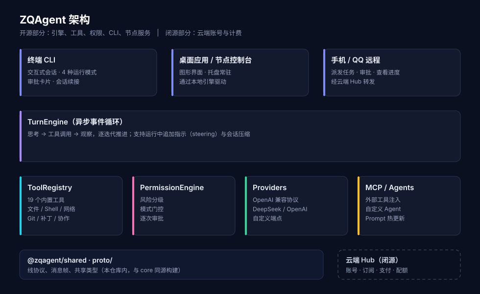

# ZQAgent

[简体中文](./README.md) · [English](./README.en.md) · **繁體中文**

**在終端、桌面或手機上，讓 AI 幫你寫程式、改檔案、跑指令——有副作用的操作會先問你。**

[](https://github.com/zqagent/zqagent/actions/workflows/ci.yml)
[](./LICENSE)
[](https://nodejs.org/)


ZQAgent 是一個可自架的 AI 編碼 Agent。它會自己讀程式碼、改檔案、跑指令，但**每一個有副作用的動作都會先問你**。

- **自備模型金鑰**：DeepSeek、OpenAI 或任意 OpenAI 相容端點，用多少付多少，不被訂閱制綁住。
- **預設需審批**：討論 / 計畫 / 互動 / 自動四種模式，寫檔案、執行指令逐次確認。
- **多端可用**：終端 CLI、桌面應用，以及從手機或 QQ 遠端派任務。
- **可擴充**：接入 MCP 外部工具，或用指令工具、自訂 Agent 擴充能力，改完即生效。

> 本儲存庫是**開源部分**：Agent 引擎、內建工具、權限系統、CLI 與節點服務。
> 雲端帳號、訂閱與計費（Hub）為閉源，但不影響本機完整使用。

---

## 安裝

**Linux（零依賴，推薦）**

```bash
curl -fsSL https://agent.cd-zq.com/install.sh | sh
```

腳本會下載對應架構的單檔可執行檔、驗證 SHA-256，並放進 `PATH`，不需要預先安裝 Node.js。

**其它平台 / 用 npm**（需要 Node.js >= 18.17）

```bash
npm i -g @zqagent/core
zqagent
```

首次啟動請輸入 `/connect`，依提示選擇 provider（OpenAI / DeepSeek / 通義千問 / 智譜 GLM / Kimi / 自訂）→
輸入 API Key → 選擇模型 → 設定推理強度。金鑰以 AES-256-GCM 加密保存在本機
`~/.config/zqagent/`，不會上傳。

也可以直接從原始碼執行：

```bash
pnpm install
pnpm build
node packages/core/bin/zqagent
```

## 快速開始

```text
$ zqagent
[interactive][code] > 讀一下這個專案，用三句話說明它在做什麼

● list_files  .
● read_file   README.md
● read_file   package.json
✓ 這是一個 TypeScript 實作的 AI Agent 引擎……

[interactive][code] > 把 src/config.ts 的預設連接埠改成 8788，然後跑測試

● read_file        src/config.ts
⏵ replace_in_file  1 處修改，等待審批
  [Y] 允許一次   [A] 總是允許   [D] 拒絕
> Y
● run_shell        pnpm test
  ✓ 42 passed
✓ 已修改預設連接埠，測試通過
```

常用指令：

| 指令 | 說明 |
| --- | --- |
| `/connect` | 設定模型連線（provider / 金鑰 / 模型 / 推理強度） |
| `/plan` | 計畫模式：唯讀探索，提出方案後等待確認 |
| `/interactive` | 互動模式：有副作用的操作逐次審批（預設） |
| `/auto` | 自動模式：全部放行（高風險，建議只在隔離環境使用） |
| `/discuss` | 討論模式：純唯讀對話 |
| `/sessions` | 列出並恢復歷史工作階段 |
| `/agent` | 切換或維護自訂 Agent |
| `/mcp` | 管理 MCP 伺服器 |
| `/tools` | 檢視全部工具及其風險等級 |

任務執行過程中可以直接輸入文字追加指示，不需等它跑完；連按兩次 `ESC` 中斷。

## 運作方式



每個任務由 `TurnEngine` 驅動：模型思考 → 呼叫工具 → 觀察結果 → 進入下一輪，
直到任務完成或達到輪次上限。

所有工具呼叫都經過 `PermissionEngine`：每個工具宣告風險等級（讀 / 寫 / 執行），
再由目前的執行模式決定是直接放行，還是跳出審批。

## 內建工具

| 類別 | 工具 |
| --- | --- |
| 檔案 | `read_file` `write_file` `replace_in_file` `list_files` `grep` |
| Shell | `run_shell` `shell_task_output` `shell_task_kill`（持續連線的 shell，支援背景任務） |
| 網路 | `web_search` `web_fetch` |
| Git | `git_log` `git_status` `git_diff` |
| 補丁 | `apply_patch` `apply_unified_diff` |
| 協作 | `ask_user` `propose_plan` `request_directory` `todo_write` |
| 探索 | `explore`（子代理：跨檔案調研，只回傳結論） |
| 媒體 | `media` `ffmpeg` `ffprobe`（影音處理，需本機有 ffmpeg） |

工具可在執行時新增、移除、停用，下一次模型呼叫立即生效。

## 安全模型

ZQAgent 的前提是**模型輸出不可信**：

- 寫檔案、執行指令、存取網路預設需要審批。
- API Key 加密保存在本機，儲存庫與日誌中不會出現明文。
- 工作區就是權限邊界：以哪個使用者、在哪個目錄啟動，就擁有該使用者對該目錄的權限。
- 不要把節點服務直接暴露到公網。

發現安全問題請**不要開公開 issue**，請依 [SECURITY.md](./SECURITY.md) 私下回報。

## 文件

| 主題 | 文件 |
| --- | --- |
| 架構與事件流 | [docs/architecture.md](./docs/architecture.md) |
| 線協議（幀 / 訊息 / 簽章） | [docs/wire-protocol.md](./docs/wire-protocol.md) |
| 上下文壓縮 | [docs/context-compaction.md](./docs/context-compaction.md) |
| 節點服務 REST API | [docs/server-api.md](./docs/server-api.md) |
| 共享函式庫（協議 / 加密 / 審批 / 通知） | [docs/shared.md](./docs/shared.md) |
| QQ 機器人 | [docs/qq-bot.md](./docs/qq-bot.md) |
| Windows 終端相容性 | [docs/windows-tool-compat.md](./docs/windows-tool-compat.md) |
| CLI 單檔（SEA）打包與排錯 | [docs/cli-sea-troubleshooting.md](./docs/cli-sea-troubleshooting.md) |
| LLM 連線錯誤排查 | [docs/llm-connection-troubleshooting.md](./docs/llm-connection-troubleshooting.md) |

使用者導向的指南（安裝、CLI 用法、Agent、MCP）：<https://agent.cd-zq.com/>

架構、線協議、REST API、共享函式庫、上下文壓縮與連線排錯另有英文版：
[architecture](./docs/en/architecture.md) · [wire-protocol](./docs/en/wire-protocol.md) ·
[server-api](./docs/en/server-api.md) · [shared](./docs/en/shared.md) ·
[context-compaction](./docs/en/context-compaction.md) ·
[llm-connection](./docs/en/llm-connection-troubleshooting.md)

## 開發

```bash
pnpm install
pnpm typecheck     # tsc --noEmit
pnpm test          # vitest
pnpm build         # tsup → dist/
pnpm dev           # 以原始碼啟動 CLI
```

提交前請閱讀 [CONTRIBUTING.md](./CONTRIBUTING.md)。涉及權限、審批、指令執行的變更會被重點審查。

## 授權

[Apache-2.0](./LICENSE)。`@zqagent` 與 ZQAgent 名稱為本專案商標，
二次散布或託管服務請勿暗示官方背書。
